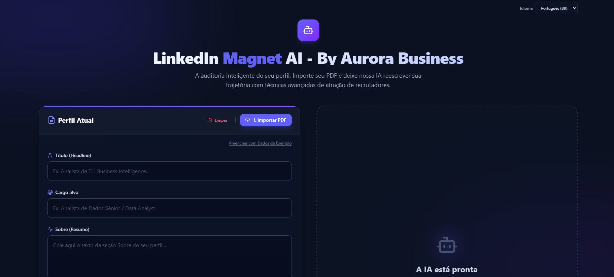

# LinkedIn Magnet AI — By Aurora Business


Uma aplicação web que faz **auditoria + reescrita do seu perfil do LinkedIn** com foco em **SEO/ATS**, usando IA para gerar um texto mais direto, mensurável e “pronto para recrutadores”.

Você pode **importar seu PDF**, revisar os campos, escolher **idioma (PT-BR / EN)** e gerar sugestões otimizadas para:

- Headline
- About
- Experiência (reescrita completa de todos os cargos, não só o último)
- Skills

## Screenshots

Coloque imagens em `public/screenshots/` e referencie aqui.

Exemplos (substitua pelos seus arquivos):




## Principais funcionalidades

- **Importação de PDF (LinkedIn export)** com extração automática de texto via PDF.js (carregado dinamicamente)
- **Reescrita por IA (Groq)** retornando JSON estruturado (score + feedback + sugestões)
- **Multi-idioma** (UI + textos gerados pela IA em PT-BR ou EN)
- **Cargo alvo** para direcionar a reescrita (headline/sobre/experiência)
- **Copiar tudo** e exportar em **Markdown (.md)** e **Word (.docx)**
- **Detector de placeholders** `[ ... ]` para lembrar de preencher métricas (ex.: % de redução, R$, tempo)
- **Preview estilo LinkedIn** para copiar e colar rapidamente
- **Persistência local** (localStorage) para não perder conteúdo ao recarregar

## Stack

- React + Vite
- Tailwind CSS
- lucide-react (ícones)
- Groq API (compatível com OpenAI-style `chat/completions`)

## Como rodar localmente

### 1) Instalar dependências

```bash
npm install
```

### 2) Configurar variáveis de ambiente

Crie um arquivo `.env.local` (não commite) a partir do `.env.example`:

```bash
copy .env.example .env.local
```

Depois, edite `.env.local` e preencha:

```env
VITE_GROQ_API_KEY="SUA_CHAVE_AQUI"
```

### 3) Rodar o projeto

```bash
npm run dev
```

Abra: http://localhost:5173

## Deploy na Vercel

1) Faça o import do repositório na Vercel
2) Configure a variável de ambiente no projeto:

- `VITE_GROQ_API_KEY` = sua chave da Groq

3) Build/Output (padrão do Vite):

- Build command: `npm run build`
- Output directory: `dist`

## Segurança (importante)

- **Nunca** coloque sua chave diretamente no código.
- Use `.env.local` localmente e Environment Variables na Vercel.
- O repositório ignora `*.local` por padrão.

## Observações

- A IA gera placeholders como `[ex.: redução de 18%]` quando faltarem métricas. Isso é intencional: você completa depois com números reais.

---

Feito por **Aurora Business**.
